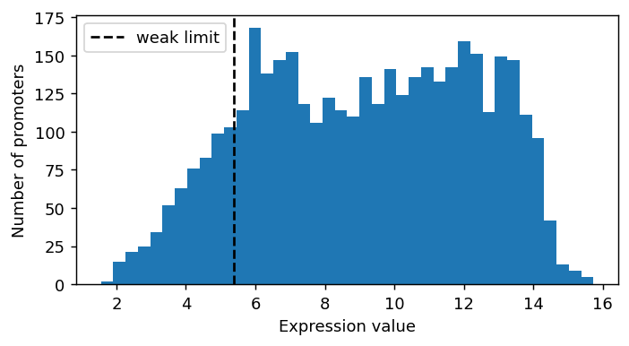
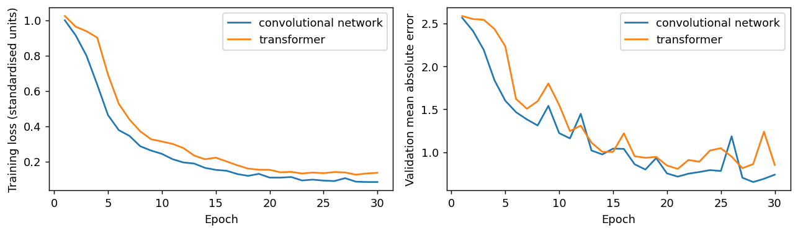
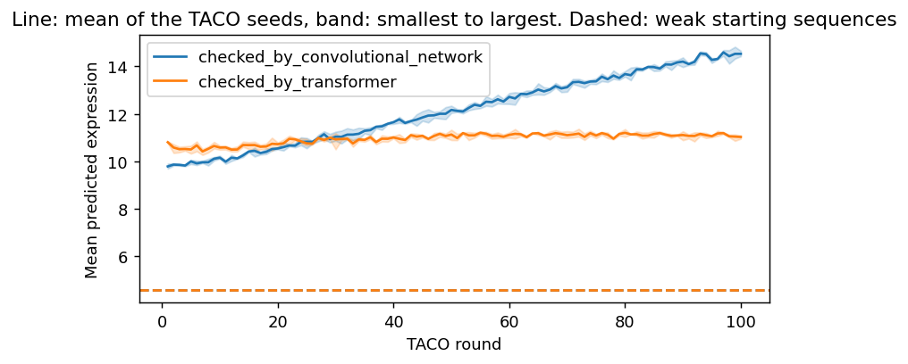

# Yeast promoter design using Reinforcement Learning 
#### *Using TACO and running on Google Colab*

This project runs the published **TACO method**<sup>1</sup> on yeast promoters. [TACO](https://github.com/yangzhao1230/TACO) teaches a DNA-writing network to design new regulatory sequences by reinforcement learning, using a scoring model that predicts how active a sequence is. This current project of mine is a small personal attempt towards learning PyTorch<sup>2</sup> and is built around existing code. Two checker networks of my own, were used as an extra control. They turned out not to be reliable judges of new sequences (see Notebook 2).

**Reinforcement learning** is a way of training in which a network tries something, receives a score (the reward), and shifts toward what scored well. In this project the *writer* writes a DNA sequence letter by letter, a frozen *judge* model scores it, and the writer is updated<sup>1</sup>.

Two notebooks make up the project:

`01_Yeast_promoter_analysis.ipynb` runs TACO on yeast promoters (task complex) with my own settings: writer = regLM yeast_reglm.ckpt, reward model = regLM paired, checker model = regLM separate, motif weight 0, 100 rounds with 256 sequences per round, seeds 0, 1 and 42. It needs a graphics card and runs on Google Colab.
`02_Checker_Neural_Networks.ipynb` trains two checker networks of my own (a convolutional network and a transformer) on native yeast promoters, and uses them to score the sequences that TACO designed. It needs no graphics card and also runs on Google Colab.

## Repository structure 

| Path | What it is | Source |
|---|---|---|
| `README.md` | Description, setup, notes and references | General Repo file |
| `.gitignore` | Files that Git should not track | General Repo file |
| `LICENSE` | MIT licence for the code of this repository | General Repo file |
| `00_requirements.txt` | Package versions | Dependencies for running the notebooks |
| `00_requirements_taco.txt` | Package versions | Dependencies for running the TACO env |
| `01_Yeast_promoter_analysis.ipynb` | The notebook analysis (Part 1: setup on Colab) | - |
| `02_Checker_Neural_Networks.ipynb` | The notebook analysis (Part 2: setup on Colab) | - |
| `figures/` | Result plots and figures | Product of the Notebook |

## Data sources and results location
No data and no result files are stored in this repository. The native promoter table is downloaded from Zenodo by the notebooks. The model files are downloaded from Zenodo into Google Drive. 

- The Native Yeast Promoters were downloaded from the `Native_complex.csv file` [Zenodo record 4436477](https://zenodo.org/records/4436477).
- The TACO Source code was downloaded from the [TACO GitHub Repository](https://github.com/yangzhao1230/TACO). 
- The regLM Source Code downloaded from the [regLM archive on Zenodo](zenodo.org/records/12668907).
- The HyenaDNA base model code was found in the [HyenaDNA Repository](https://github.com/HazyResearch/hyena-dna).

The TACO result tables (about 3 megabytes per seed) and the trained checker networks stay in Google Drive, to save space. Only a few small pictures, saved by the notebooks into the Drive folder results/figures, were copied by hand into `figures/` of this repository. The tables of numbers in this README are summaries copied from the notebook outputs.

#### Google Drive directory structure

```text
Reinforcement_Learning_for_Promoter_Design/
  taco_code/TACO-main.zip   TACO source code
  model_files/              regLM model files
  data/                     starting sequences, native promoter table
  results/                  TACO result tables, checker network files
```

## Setup

The heavy part runs on Google Colab, because the laptop has no graphics card from NVIDIA. TACO's own code reads files from the authors' computer, so the notebook finds those paths and they are changed in a working copy.

1. Create a folder called `Reinforcement_Learning_for_Promoter_Design_colab` in Google Drive, with the subfolders `taco_code`, `model_files`, `data` and `results`. Upload `TACO-main.zip` into `taco_code`.
2. In Colab, open the notebook from GitHub (File, then Open notebook, then the GitHub tab).
3. Choose a graphics card: Runtime, then Change runtime type, then pick a card (a Tesla T4 was given on 2026-11-13).
4. Run the notebook from top to bottom. Colab asks permission to reach Drive.

[to add later: local setup with a virtual environment in Visual Studio Code, if any step is run on the laptop]

## RESULTS & CONCLUSIONS

#### **Notebook 1**: TACO on yeast promoters (three seeds)

TACO starts from 200 weak native promoters (expression below 5.391858; 554 weak promoters exist in the table of 3929). In each round the writer writes 256 sequences, the reward model scores them, and the writer is updated. The checker model (a second regLM model that is not used for the updates) scores the same sequences. top is the mean score of the 16 best sequences of a round, fitness the median of the best 128; both scores are scaled by TACO between a minimum and a maximum, so values above 1 are possible.

TACO scores over the rounds for three seeds

Last round (100) over the three seeds, mean and standard deviation:

Measure	Mean	Standard deviation
top (reward model)	1.078	0.012
fitness (reward model)	1.004	0.006
top (checker model)	1.064	0.009
fitness (checker model)	1.022	0.009
diversity	53.667	0.577
novelty	54.167	0.289
All three seeds rise in the same way, and the checker model follows the reward model. The checker model's rise flattens after about round 80.
Diversity (median number of positions at which two of the best 128 sequences differ) falls from about 59 at round 10 to about 54 at round 100. Novelty (median distance to the closest starting sequence) stays between 52 and 54.5 positions out of 80.
Looking into the result file of seed 0: the best sequence of round 1 already differs from its closest starting sequence at 48 of 80 positions, that of round 50 at 53, and that of round 100 at 54. The designs do not start from the starting sequences and change them step by step. They are written by the writer, and the starting sequences only fill its memory at the start.

#### **Notebook 2**: my own checker networks

**The data.** 3929 native promoters were kept, all different from each other. The expression values range from about 2 to about 16, and 554 promoters are weak (below 5.391858).



**The table consists of groups of near-identical promoters.** If the 3929 promoters are connected whenever they differ at a limit number of positions or fewer (directly or through a chain), the table falls into exactly 200 groups at every limit from 2 to 30 positions. The largest group has 21 sequences, and no sequence is alone. At a limit of 40 positions, two groups merge (199 groups, the largest with 40 sequences). Promoters inside one group therefore differ at 2 positions or fewer, and promoters from different groups differ at more than 30 positions. This looks like a library built from 200 base sequences with about 20 variants each. That reading is not tested.

**Why a random split is not used.** In a random split, every one of the 394 test promoters has a training promoter that differs at only 1 or 2 of the 80 positions. A network tested this way is tested on close variants of sequences it has already seen. The notebook therefore splits **by groups** (limit of 5 positions): whole groups go into training, validation or test, 160, 20 and 20 groups, with 3154, 372 and 403 promoters. For the grouped split, the nearest training promoter of a test promoter differs at a median of 48 positions (smallest 38, largest 51), and no test promoter has a training promoter within 20 positions.

**What is the training mean?** The training mean is the simplest possible prediction: one single number, the same for every promoter. It is the mean of the measured expression values of all promoters in the training split (3154 promoters): all values are added up and the sum is divided by 3154. It is calculated once, from the training split only. The validation and test splits are never used for it, because they must stay unseen. It serves as the **baseline**, the bar that a network has to beat. Every test promoter receives the same prediction, the training mean, and the **mean absolute error** of the baseline is the mean distance between each measured test value and that one number. For example, if the training mean is 10 and a test promoter was measured at 7, that promoter contributes an error of 3. All errors are averaged over the 403 test promoters. A network with a larger error than this baseline predicts worse than a guess that ignores the sequence completely. The same training mean (together with the training standard deviation) is also used to standardise the expression values before training, so that the networks work with numbers around zero.

**Result: the networks do not predict the expression of promoters from new groups.** Always predicting the training mean gives a mean absolute error of 2.78 (validation) and 2.26 (test). Test split, three training seeds (0, 1, 42), mean and standard deviation:

| Network (learnable numbers) | Mean absolute error | Pearson correlation | Spearman correlation |
|---|---|---|---|
| Convolutional network (76353) | 2.781 (0.172) | 0.204 (0.110) | 0.206 (0.073) |
| Transformer (72449) | 2.964 (0.220) | -0.264 (0.011) | -0.297 (0.028) |
| Baseline: training mean | 2.262 | - | - |

Both networks have a larger error than the baseline on the test split. The transformer's correlation is negative for all three seeds. The training loss falls close to zero for both networks, but the validation error does not follow: it stays near 2.0 to 2.3 for the convolutional network (baseline 2.78) and rises to about 3.8 for the transformer.



The test split holds only 20 groups, so these numbers depend on which groups landed there. A random split gave much better numbers because close variants of the test promoters were in training. With only about 160 distinct groups in training, the networks may simply have too little independent data to learn general rules. This is not tested here.

**Checking TACO's designs (three TACO seeds, 76800 sequences).** The weak starting sequences score on average 5.62 with the convolutional network and 9.17 with the transformer (all of them have a measured expression below 5.39). The table shows the mean predicted expression per round, with the smallest and largest value over the three TACO seeds in brackets:

| Round | Convolutional network | Transformer |
|---|---|---|
| 1 | 10.96 (10.88 to 11.06) | 10.96 (10.93 to 11.00) |
| 10 | 11.24 (11.22 to 11.25) | 11.02 (10.97 to 11.05) |
| 30 | 12.20 (12.07 to 12.41) | 11.36 (11.27 to 11.45) |
| 50 | 13.31 (13.17 to 13.50) | 11.75 (11.70 to 11.82) |
| 70 | 14.23 (14.05 to 14.38) | 12.02 (11.99 to 12.06) |
| 100 | 15.57 (15.46 to 15.75) | 12.38 (12.35 to 12.43) |



Agreement with the score of TACO's own checker model (Spearman correlation with `oracle_score`), for each TACO seed (0, 1, 42):

| Network | Over all rounds together | Inside single rounds |
|---|---|---|
| Convolutional network | 0.663, 0.645, 0.641 | 0.400, 0.399, 0.385 |
| Transformer | 0.654, 0.637, 0.632 | 0.393, 0.396, 0.376 |

- Both networks predict a steady rise over the rounds, and both agree to a similar degree with TACO's checker model, inside single rounds (about 0.39) as well as over all rounds together (about 0.64).
- Because neither network predicts the expression of promoters from new groups, this agreement is hard to interpret. It may come from something simple in the sequences that both TACO's checker model and my networks react to. This is not tested here.
- In the printed examples, the starting sequences contain about 40 percent G and C, and the designed sequences about 66 to 79 percent. This was only counted by eye on eight printed sequences. A count over all designs is not done yet.
- A predicted mean of 15.6 lies at the upper end of the native values, so these predictions are extrapolations. They are not expression levels measured in a cell.

**Conclusion for this project.** The independent check of TACO's designs is therefore TACO's own checker model (`oracle_score`), which rises together with the reward model in all three seeds (notebook 1). My own networks are a learning exercise, and the finding of notebook 2 is the limit of what can be learned from this table when related promoters are kept apart.

## Documentation and versions

### Environment used *[to be updated as I go]*

| Item | Version or detail |
|---|---|
| Platform | 	Google Colab |
| Graphics card (notebook 1) | Tesla T4 (2026-11-15) |
| Python on Colab - Notebook 1 | 3.13.16 |
| Python on Colab - Notebook 2 | 3.13.18 |
| Python in taco_env | 3.9.25 |
| Date of setup | 2026-11-10 |

### Package versions *[to be updated as I go]*

The exact versions are pinned in `00_requirements.txt` & `00_requirements_taco.txt`. They were taken from the working environment after the first successful run:

| Package | Colab Version | taco_env |
|---|---|
| torch | 2.14.1 (processor-only build) | 2.1.0+cu121 |
| numpy | 2.4.6 | 1.26.4 |
| pandas |	2.2.3 | - | 
| scipy | 1.16.3 | - | 
| matplotlib | 3.10.0 | - | 
| pytorch-lightning | - | 1.8.6 | 
| transformers | - | 4.55.4 | 
| FlashAttention | - | 	2.5.9.post1 | 

## References

1. Yang Z, Su B, Cao C, Wen JR. Regulatory DNA sequence design with reinforcement learning. In: International Conference on Learning Representations. 2025. arXiv:2503.07981. Code (MIT licence): https://github.com/yangzhao1230/TACO
2. Paszke A, Gross S, Massa F, et al. PyTorch: an imperative style, high-performance deep learning library. In: Wallach H, Larochelle H, Beygelzimer A, d’Alché-Buc F, Fox E, Garnett R, eds. Advances in Neural Information Processing Systems 32. Curran Associates, Inc.; 2019:8024-8035.
3. Lal A, Garfield D, Biancalani T, Eraslan G. Designing realistic regulatory DNA with autoregressive language models. *Genome Res*. 2024;34(9):1411-1420. doi:10.1101/gr.279142.124
4. Nguyen E, Poli M, Faizi M, et al. HyenaDNA: long-range genomic sequence modeling at single nucleotide resolution. *Advances in Neural Information Processing Systems*. 2023;36. arXiv:2306.15794. Code: https://github.com/HazyResearch/hyena-dna
